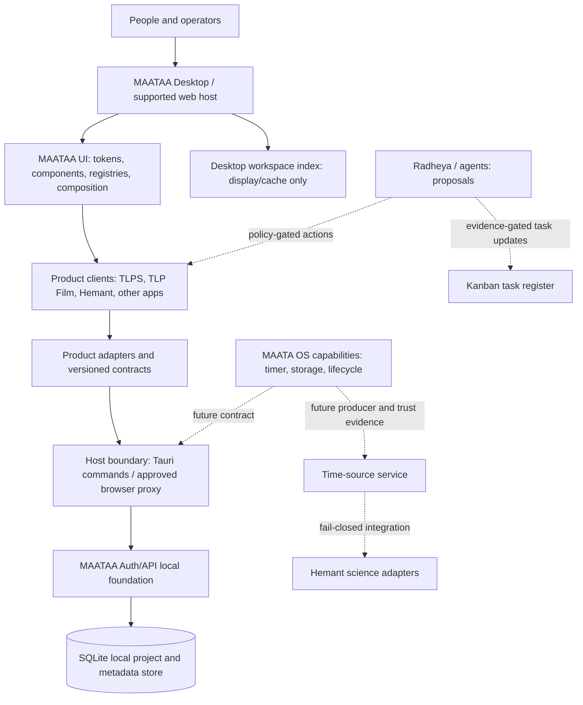

# MAATAA Ecosystem Product Requirements

**Status:** Draft for product and architecture review  
**Last reviewed:** 12 October 2026  
**Scope:** MAATAA UI, MAATAA Desktop, product apps, local platform services, and the proposed MAATAA OS/Radheya boundary.  
**Evidence boundary:** This document describes repository evidence and requirements. It does not certify a release, production service, scientific result, customer pilot, or security review.

This document is the connective product brief for four related layers: **Product Requirements → Design System → Architecture → Agent Instructions**. It gives each layer an owner and boundary so that related apps can work as one ecosystem without pretending that unfinished integrations are already live.

## 1. Product requirements

### 1.1 Product vision

MAATAA is a family of useful, independently understandable applications that share a coherent interaction language and can exchange explicitly versioned project records through reviewed host and service boundaries. A user should be able to recognize the same shell and design system across products, understand where each record lives, and tell whether an action is local, connected, proposed, or externally accepted.

The ecosystem is not one application with one universal database. Each product owns its domain workflow; shared platform services provide only the cross-product capabilities that have been implemented and qualified.

### 1.2 User groups

| User | Need | Product boundary |
|---|---|---|
| App user or project contributor | Open the right product, complete a workflow, and understand save and review status | Product apps own their domain UI and workflow |
| Product owner/operator | Configure supported workflows, review records, and see operational boundaries | Host app and service configuration; role labels alone are not authorization |
| UI integrator | Discover stable components, tokens, registries, and composition contracts | `@maataa/ui` owns visual contracts, not business services |
| Platform maintainer | Maintain Desktop IPC, Auth/API, storage contracts, migrations, and release evidence | Platform services own runtime authority and persistence |
| Research user | Inspect astronomy/calendar outputs with method, source, frame, time scale, and uncertainty | Hemant remains a research workbench until its methods and data are independently validated |

### 1.3 Product inventory and current maturity

| Layer/product | Current evidence | Required interpretation |
|---|---|---|
| MAATAA UI | React/TypeScript package with atomic components, registries, composition/runtime surfaces, and explorer/composer work | Shared design and composition system; not an app backend, identity provider, or authorization layer |
| MAATAA Desktop | Tauri trial shell opening MAATAA UI, Browser, TLPS, TLP Film, and Support Center windows | Local desktop host; native product-to-service flow needs exact-build acceptance |
| TLPS | Planning workflow, work-area catalogue, local browser persistence, service adapters and API contracts | Local planning prototype; local approval is not an authenticated business approval |
| TLP Film | Separate film lifecycle workspace and local handoff path | Product-specific workflow; no shared production backend is implied |
| Auth/API | Rust service, SQLite, bootstrap administration, project-scoped tokens, project/version and metadata routes | Local foundation/prototype; not production identity or a public service |
| MAATA OS / clock | Clock-source and boot-report contracts, with host wall-clock displayed as unverified | No live OS timer/RTC trust bridge is established |
| Radheya / agents | Architecture and contract direction | No general live agent connector or autonomous execution authority is implied |
| Kanban | Browser-local roadmap/task state in current workbench surfaces | Not a shared, multi-agent task service |
| Hemant Observatory | Local astronomy/Panchanga research workbench and Three.js visualization direction | Separate scientific workstream; no MAATA OS verified-clock connection or full validated planetarium claim |
| ALLB and other galleries | Static or locally browsable visual material | Visual/product assets only unless a specific workflow and persistence path is evidenced |

### 1.4 Core user journeys

1. **Discover and launch:** User opens a product from MAATAA Desktop. The shell identifies each window and keeps external Browser content separate from privileged product views.
2. **Plan locally:** TLPS user creates or edits a plan. The UI labels local data and sample content, validates fields, and supports export without suggesting a booking, payment, or external approval occurred.
3. **Connect a project record:** When enabled, TLPS requests an API connection through its selected transport. Desktop holds the project token outside the renderer and forwards only allow-listed project routes. The API is authoritative for the shared project ID/version; the Desktop project index is a cache/display, not a second authority.
4. **Transfer a version:** A save sends a versioned project record and artifact metadata/digest under optimistic concurrency. The service rejects stale versions. Any snapshot body retention policy must be explicit; a digest alone is not a backup of the plan.
5. **Continue across products:** TLPS can offer a deliberate handoff to TLP Film. The receiving app asks before importing; it does not imply that external production work started.
6. **Use science tools:** Hemant displays source/method/time-scale/frame/uncertainty provenance where available and marks missing source evidence unresolved. It must not inherit MAATA OS trust merely because it displays a host clock.

### 1.5 Functional requirements

| ID | Requirement | Acceptance evidence |
|---|---|---|
| PR-01 | Every product entry states its maturity, data boundary, and available actions. | Product catalogue test plus native/window smoke review; no catalogue-only item presented as runnable. |
| PR-02 | Desktop can launch supported product windows and keep external Browser windows isolated from Desktop commands. | Native macOS test for each launch path; browser content cannot invoke privileged commands. |
| PR-03 | TLPS makes local-only and API-connected state distinguishable, with save result and current version visible. | UI states and native flow test for local save, connected save, conflict, disconnected API, and reconnect. |
| PR-04 | Desktop project list parses the current index schema and preserves existing records during migration. | Fixture-backed migration tests for supported schema versions, plus native display of a TLPS record. |
| PR-05 | Product-to-API calls pass through a narrow, versioned contract and an allow-list. | Contract tests, authorization tests, and native IPC request/response test. |
| PR-06 | Browser-local project/work-area data can be exported and restored under a documented schema. | Snapshot export/import between isolated profiles and same-origin refresh tests. |
| PR-07 | Work-area catalog entries accurately distinguish runnable, local-demo, and catalogue-only status. | Registry validator and UI test; Core Platform must not promise an unavailable Auth API selection. |
| PR-08 | Cross-product handoff is explicit, reviewable, and does not imply an external booking or production action. | User-flow test and data-preservation test. |
| PR-09 | Kanban tasks are tied to stable task IDs, dependencies, owners/inputs, and evidence; sync is not claimed until a shared service exists. | Snapshot schema and UI state tests; local persistence labeled local. |
| PR-10 | Science outputs retain source, method version, frame, time scale, units, uncertainty, and input provenance. | Fixture-backed manifest validation; unresolved values remain null. |
| PR-11 | Agent proposals cannot directly authorize external actions, change policy, or mark evidence-backed completion without evidence. | Capability policy tests and audit trail for any approved write operation. |

### 1.6 Non-functional requirements

- **Truthful maturity:** Use `implemented`, `tested`, `provisional`, `pending`, `blocked`, and `environment-blocked` distinctly. Build success is not acceptance; acceptance is not release certification.
- **Local-first safety:** Preserve local records and exports. Never run an implicit data migration that discards or rewrites user data.
- **Security:** Secrets stay out of renderer storage, exports, logs, and screenshots. Every privileged request has a narrow route, project scope, size limit, timeout, and fail-closed error.
- **Privacy:** Record only necessary metadata. Establish retention, deletion, export, backup, and recovery before using real customer data.
- **Accessibility:** Keyboard, screen-reader, zoom/reflow, reduced-motion, and real-device checks are separate acceptance evidence; automation does not replace manual review.
- **Performance:** Targets are selected with product owners and measured on named devices/browsers before a pilot. Do not invent release thresholds.
- **Reproducibility:** Every qualified artifact identifies exact source revision, dependency lock, commands, environment, and output checksums.

### 1.7 Out of scope until separately approved and evidenced

- Public or multi-tenant production Auth/API deployment, general identity/passkeys, canonical DBB/HKDB service, DB Studio, and service SLOs.
- Flight/hardware clock verification, trusted boot claims, spacecraft-critical use, or scientific validation without authoritative data and independent reference vectors.
- Aditya-L1 MAG commercial use without written permission; access or possession is not a grant of redistribution or commercial rights.
- Autonomous agent writes, external messages, purchases, booking, deployment, DNS changes, or publishing without explicit authority and a reviewed action boundary.
- Selecting a canonical Panchanga tradition, default location, clock tolerance, or unresolved policy on behalf of the owner.

## 2. Design system

### 2.1 Purpose and ownership

`@maataa/ui` is the shared visual and composition layer. It owns design tokens, atomic components, reusable shells, canonical UI registries, composition schema/runtime, and accessibility behavior of its own components. It does not own product data, routing authority, identity, authorization, API execution, secrets, or service persistence.

Product apps own their domain language and workflows. They should consume the shared package through public exports and avoid private source imports or copied component implementations.

### 2.2 Design principles

1. **One recognizable system, product-specific vocabulary:** Shared navigation, controls, feedback, spacing, and accessibility conventions; product-specific workflows remain in their applications.
2. **State is visible:** Distinguish local draft, saved locally, connected, pending, conflict, failed, sample, and externally approved states in text as well as color.
3. **Permission is not appearance:** A role picker or UI catalogue is guidance; only the host/service enforces authorization.
4. **Evidence is adjacent:** Show the source, version, time basis, and limits next to consequential data or calculations.
5. **Progressive complexity:** A user can complete the main task without understanding registries or infrastructure, while operators can inspect provenance and diagnostics.

### 2.3 Shared UI requirements

- Use semantic, keyboard-operable components with stable labels, focus behavior, error associations, and visible focus indicators.
- Provide loading, empty, success, conflict, offline, permission-denied, and retry states for each connected workflow.
- Keep desktop shell, browser shell, mobile shell, and in-app product navigation compositionally consistent without forcing identical layouts.
- Provide non-color status indicators and text equivalents for chart, telemetry, and science states.
- Respect reduced motion and avoid conveying critical meaning only through 3D, animation, color, or sound.
- Use tokens for color, spacing, type, radius, elevation, motion, and focus. Product-specific visual accents must map to tokens instead of creating one-off parallel systems.
- Maintain canonical stable IDs for registries. A display label change must not silently change saved composition identity.

### 2.4 Design acceptance

A shared component is accepted when it has a documented public export, representative usage, deterministic states, responsive behavior, keyboard and screen-reader semantics, and tests that exercise behavior rather than duplicate implementation details. A design-system specimen is not evidence that the underlying product workflow is connected.

## 3. Architecture

### 3.1 Layer model

Dashed lines are target integrations, not current runtime guarantees. The documented UI architecture is registry → workspace → page → layout → region/slot → composition → component → atom. That UI chain is separate from the host/service chain above.

### 3.2 Ownership and source of truth

| Record/capability | Authority | Cache or presentation copy | Boundary |
|---|---|---|---|
| UI tokens, component IDs, composition schema | MAATAA UI package | App bundles and generated previews | UI package cannot grant runtime authority |
| TLPS plan and work-area registers | TLPS product | Browser storage; optional artifact metadata/version link in API/ Desktop | Product owns plan meaning; API version is authoritative only for API-backed records |
| Project identity/version | Auth/API when connected | Desktop project index (`apiLink`) | Desktop cache is updated from API response; product renderer cannot set authority fields |
| Desktop window/session/token | MAATAA Desktop host | Per-window display state | Renderer receives only allow-listed commands; token remains outside renderer |
| Film handoff | Sending and receiving product contracts | Local handoff record | Receiving product asks before import |
| Clock source and trust | OS/runtime source contract, when implemented | UI may display a labeled snapshot | Host wall clock remains unverified; monotonic ticks are not astro-time verification |
| Hemant calculation output | Hemant method/data adapter | Export manifest and local view | Every output carries method/source/frame/time-scale/uncertainty; absent evidence remains unresolved |
| Agent action | Human/host policy | Proposal and audit evidence | Agent output alone cannot authorize mutation or completion |
| Kanban status | Task service if one is implemented; otherwise this browser's local state | Local board | Do not call local browser state live/shared |

### 3.3 Security and data flow requirements

- Desktop is a capability broker, not a general-purpose proxy. Commands must validate caller window/product identity, request schema, route, project scope, payload size, timeout, and response shape.
- Current working-copy security design places Desktop-to-Auth/API traffic on a private Unix-domain socket and keeps the loopback HTTP listener for local development proxy use. Native end-to-end confirmation for the exact current candidate remains required; socket permissions do not authenticate a malicious process running as the same user.
- The API stores project/version metadata and snapshot digest/size according to its contract; do not imply that a digest is a recoverable copy of the plan body.
- All cross-service records use explicit schema versions, stable IDs, request/correlation IDs, idempotency/concurrency rules, bounded payloads, and safe error codes.
- Events are ordered by monotonic sequence/version. Wall-clock time is display metadata only unless a separately approved, sourced trust policy establishes otherwise.
- Browser windows loading arbitrary sites receive no privileged Tauri commands or project credentials.
- Each product owns local migration and export/import. Data from an unsupported schema is preserved for recovery and rejected from destructive conversion.

### 3.4 Deployment topology

The current product target is local development/trial. A future deployment design must name the operator, identity authority, service endpoints, secrets handling, database ownership, data residency evidence, TLS, backups, restore targets, monitoring, incident route, and rollback. No hosting vendor or region is selected by this PRD; a vendor location label is not proof of residency.

## 4. Agent instructions

These instructions apply to coding and research agents working in this ecosystem:

1. **Inspect before editing.** Record repository root, branch, exact commit, dirty paths, relevant `AGENTS.md`, existing product docs, and test scripts. Never overwrite or silently stage unrelated changes.
2. **Keep tasks atomic.** State one outcome, its dependencies, acceptance test, evidence path, and owner/input. Separate implementation from external approvals, legal review, manual accessibility review, and release certification.
3. **Honor ownership boundaries.** Put shared visual behavior in `@maataa/ui`; domain workflows in their product; privileged access in the host/service; OS capabilities behind explicit contracts. Do not bypass public package exports or IPC allow-lists.
4. **No invented truth.** Do not fabricate scientific vectors, licenses, source permissions, user approvals, customers, hardware trust, deployment facts, test results, or performance targets. Use null/unresolved and create a blocker when evidence is missing.
5. **Fail closed.** Unknown schema/version, invalid identity/scope, stale version, missing provenance, oversized input, timeout, unsafe socket, and unsupported data must not yield partial privileged or scientific results.
6. **Protect credentials and user data.** Do not print tokens or secrets. Keep test credentials in private temporary paths, use synthetic data, and remove disposable test state after verification when safe.
7. **Validate proportionally.** Run focused tests, then the repository's required checks for the change. Record exact command, revision, pass/fail/skip, and environment blockers. Do not call a test passed when it was skipped, isolated-only, or run on another revision.
8. **Respect current documentation.** Use Context7 for current library/framework/CLI documentation when changing or debugging those technologies. Existing repository policy and user instructions take precedence over stale notes.
9. **Use precise status labels.** `Implemented` means code/docs exist; `Tested` means the exact behavior passed a named check; `Provisional` means an explicitly temporary choice; `Pending` means an input or gate remains; `Environment-blocked` means the environment prevented the check; `External-blocked` means another party or permission is required.
10. **No unrequested consequential action.** Do not deploy, publish, push, change DNS, contact third parties, accept terms, widen access, or commit unless explicitly requested. Prepare a reviewable result first.
11. **Close the loop.** Update the owning task/evidence record with the result and link to the changed file or test. If the UI board is browser-local, say so and do not present it as shared live status.

## 5. Release and acceptance gates

| Gate | What closes it | Current disposition |
|---|---|---|
| G1 — Product boundary | Owners approve product scope, authority matrix, and supported client list | **Pending**; this document is a draft |
| G2 — Design-system adoption | Supported apps use public MAATAA UI exports and pass visual/accessibility contracts | **In progress by product**; do not infer ecosystem-wide adoption |
| G3 — Desktop index integrity | Current and prior local records load, save, migrate, and display without loss | **Blocked** by unsupported project-list format observed in native trial |
| G4 — TLPS/Auth API native path | Core Platform selection, token connect, save v1, Desktop list update, stale-write rejection | **Pending**; native run did not reach this flow |
| G5 — Host security | Exact-build IPC allow-list, token isolation, browser isolation, local service identity limitations reviewed | **Pending exact candidate**; current working-copy Unix-socket design needs native verification and review |
| G6 — Snapshot and recovery | Real snapshot export/import across profiles, integrity comparison, two-tab refresh; retention and recovery rules recorded | **Pending** |
| G7 — OS/Radheya/Kanban | OS producer, IPC, agent action approval, and shared task-state contract tested end-to-end | **Pending/design boundary** |
| G8 — Product pilots and manual acceptance | Named owners, isolated pilot tenant, real-device and screen-reader reviewers, legal/licensing approvals | **External/manual pending** |
| G9 — Exact-candidate qualification | Clean exact commit passes required automation; manual/external results remain separately recorded | **Pending**; do not transfer evidence between commits |

## 6. Decisions intentionally left open

- Product owner approval of the ecosystem's first supported release scope.
- Whether the Auth/API remains an owner-run local service, is hosted later, or splits into separate services.
- Snapshot body retention and restore policy; current digest/size metadata is not the body.
- Pilot tenants, named participants, support commitments, and performance targets.
- Private security-reporting destination and response ownership.
- Legal approvals for assets, datasets, and software licenses.
- Any canonical calendar/tradition, location, clock tolerance, or astronomical method. This PRD selects none.

## 7. Immediate implementation sequence

1. Fix and regression-test Desktop project-index parsing/migration without losing existing records.
2. Make the TLPS Core Platform/Auth API work area genuinely selectable only if its service adapter is available; otherwise show an explicit blocked state rather than a dead catalogue tile.
3. Run the native TLPS → Desktop IPC → local Auth/API → SQLite version round-trip on the same clean candidate, including a stale-version conflict and browser-window isolation check.
4. Add a versioned register/snapshot artifact contract and verify export/import in a second browser profile before calling it portable.
5. Decide and implement Desktop service lifecycle and evidence panels for OS boot report and ALLB check-in; keep them informational and unverified where source trust is absent.
6. Connect the separate script upload → breakdown → human approval → schedule workflow through product-owned records and explicit API contracts.
7. Re-run full qualification on the resulting exact clean commit, then update the release evidence pack. Manual and external gates remain separate.

---

**Interpretation note:** The repository contains substantial architecture and prototype code, but shared navigation is not the same as shared persistence, identity, authorization, or operations. This PRD makes those connections explicit so that each next implementation can be tested as part of the whole system.
