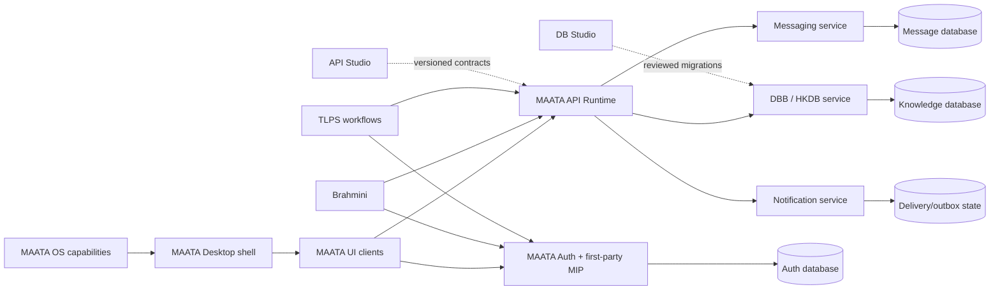

# MAATAA Production Service Roadmap

**Status: ordered engineering plan, not production certification.** This plan assumes owner-controlled infrastructure and data, a first-party MAATAA Identity Protocol (MIP), and maintained cryptographic implementations. It does not assume a managed SaaS identity, database, queue, notification or messaging provider.

## Current evidence

- `apps/maataa-auth-api` is a locally tested, loopback-only Rust process with SQLite, bootstrap-token administration, scoped opaque tokens, project records and an HKDB-shaped metadata slice. It is not a human identity provider, a standalone DBB, or a public API service.
- MIP v1 has a design draft in `MAATAA-IDENTITY-PROTOCOL-V1.md`; there is no passkey login/session implementation yet.
- No canonical production MAATA Auth, DBB/HKDB, API Runtime, notification or messaging deployment was established by the current review.
- Desktop, MAATA UI, Brahmini and TLPS shared-project tests are not proof that these clients use one deployed Auth/API/DBB authority.
- Owned host, domain, TLS termination, operational SLO, RPO/RTO, data retention and message-encryption policy are not yet specified. Until selected and tested, no production-readiness claim is valid.
- Owner has assigned `allb.xyz` to MAATAA services, `tlps.in` to TLPS only, and `nevoevents.in` to NEVO; NEVO DNS is reported to use a separate Cloudflare account. Proposed hosts, central MIP issuer and TLPS auth handoff are captured in `MAATAA-DOMAIN-AUTHORITY-MAP.md`; registrar/DNS control and live configuration are still unverified.
- The executable dependency order and close criteria are summarized in `MAATAA-SERVICE-FABRIC-EXECUTION-PLAN.md`; the transactional delivery contract is specified in `MAATAA-NOTIFICATION-OUTBOX-DESIGN.md`. Both are designs/plans, not proof of implementation.

## Target boundaries

The OS provides narrow capabilities such as secure local storage, clock provenance, process/window lifecycle and notifications. It does not own business identity, application authorization, or domain databases. MAATA Auth is authoritative for principals, authenticators, sessions, membership and grants. DBB/HKDB is authoritative for shared, approved knowledge and provenance. TLPS remains authoritative for film/content records. Messaging owns conversations and message history. Notifications deliver references and minimal content; they are not the message store. Each service owns its schema and migrations; clients never receive database credentials.

## Atomic sequence and acceptance gates

Run steps in order. A phase closes only when its artifacts, tests and evidence are present; a green compile alone never closes a production gate.

| Gate | Atomic work | Required evidence to close |
|---|---|---|
| **0. Inventory and authority** | 0.1 Freeze the inspected commit and record dirty paths. 0.2 Inventory all Auth/DB/API/DBB/notification/message sources and deployments. 0.3 Assign exactly one owner/source of truth per record type. 0.4 Mark prototypes, demos and canonical services separately. 0.5 Preserve existing local data; define no automatic migration. | Reproducible source inventory, authority table, data-owner matrix and clean evidence log. No guessed service is treated as canonical. |
| **1. Product and risk contract** | 1.1 List user classes and clients: Desktop, MAATA UI, Brahmini, TLPS, operators and service accounts. 1.2 Classify identity, knowledge, content, message and telemetry data. 1.3 Define tenancy and project isolation. 1.4 Set retention, deletion/export, audit visibility and recovery rules. 1.5 Set per-service availability targets, latency/error budgets, RPO/RTO and peak load from real expected use. 1.6 Decide whether messaging needs end-to-end encryption before storing message bodies. 1.7 Document threat actors, assets, trust boundaries, abuse cases and incident roles. | Approved product/security requirements; no production data until unresolved classifications and targets have owners. |
| **2. Protocol and contracts** | 2.1 Review/freeze MIP v1 issuer, client, authenticator, session, recovery and revocation state machines. 2.2 Freeze request/response schemas and stable error codes. 2.3 Define API versioning, pagination, idempotency keys, optimistic concurrency and deprecation. 2.4 Define DBB knowledge-object, assertion, relation, provenance, lineage and verification contracts. 2.5 Define event envelope: event ID, schema version, producer, tenant/project, occurred/recorded time basis, correlation/causation IDs and privacy classification. 2.6 Define message and notification contracts separately. 2.7 Generate contract fixtures and backward-compatibility tests. | Reviewed, versioned protocol/API/event/schema specs; rejection tests for unknown versions, malformed payloads, cross-tenant references and unsupported verification claims. |
| **3. Owned platform foundation** | 3.1 Select owner-operated hosts and isolated dev/test/stage/prod environments. 3.2 Record MAATA `allb.xyz`, TLPS `tlps.in`, and NEVO `nevoevents.in` ownership split; verify registrar/DNS access, including NEVO's separately administered Cloudflare account, DNSSEC, CAA and TTL/change process. The newer supplied TLPS snapshot omits the former `staging.nevo.tlps.in` record; verify live removal and whether NEVO staging moved under NEVO ownership. 3.3 Define TLS termination/certificates/automated renewal for exact hosts and private service-to-service network. 3.4 Choose an owner-operated secrets and key-management mechanism. 3.5 Establish non-root service identities, filesystem permissions, egress allowlists and firewall policy. 3.6 Pin toolchains/images/dependencies and produce SBOMs. 3.7 Add reproducible build, signed artifacts, vulnerability scanning and protected CI. 3.8 Add redacted structured logs, metrics, traces, request IDs and alert ownership. | Infrastructure-as-code or reproducible deployment definitions; security review; live registrar/DNS/TLS and network evidence; no public listener until ingress and secret handling are verified. The owner split or export diff alone does not close Gate 3.2. |
| **4. Database and migration foundation** | 4.1 Select PostgreSQL version and operator-owned topology for shared services; keep local SQLite only for dev/test where suitable. 4.2 Separate Auth, HKDB, messaging and notification schemas/roles and credentials. 4.3 Require TLS/private networking, least privilege, bounded connections and statement/transaction timeouts. 4.4 Build forward-only reviewed migrations with checksums and compatibility policy. 4.5 Add tenant/project constraints and adversarial isolation tests. 4.6 Configure encrypted backups and continuous WAL archive/PITR on owner-controlled storage. 4.7 Practice restore to an isolated environment and measure actual RPO/RTO. 4.8 Test capacity, pool saturation, failover and recovery. | Fresh install and upgrade tests; isolation tests; verified restore drill with observed RPO/RTO; no production data imported. PostgreSQL PITR depends on a continuous WAL archive and a tested restore process ([PostgreSQL PITR guide](https://www.postgresql.org/docs/current/continuous-archiving.html)). |
| **5. MAATA Auth and MIP** | 5.1 Create a dedicated Auth service boundary and database; migrate no prototype identities by default. 5.2 Set issuer `https://auth.allb.xyz`, RP ID direction `allb.xyz`, v1 ceremony origin `https://auth.allb.xyz`, and exact MIP client/callback registry; keep WebAuthn origins separate from app redirect origins. 5.3 Implement invite-only enrollment and one-use, expiring, purpose-bound passkey challenges using a maintained WebAuthn verifier. 5.4 Verify signatures, challenge, origin, RP ID, user-presence/verification policy and credential status. 5.5 Atomically consume challenges and reject replay/race attempts. 5.6 Implement TLPS top-level redirect and short-lived code exchange, bound to exact callback/client, state and PKCE; do not return API credentials in the front channel. 5.7 Issue separate host-only Auth and TLPS sessions; add rotation, idle/absolute expiry, CSRF and logout. 5.8 Add authenticator add/remove, per-device/session list, revoke-one and revoke-all. 5.9 Add owner-controlled recovery with step-up, cooling-off and immutable audit events. 5.10 Add organization membership, roles and project grants with deny-by-default policy. 5.11 Add abuse controls, generic auth failures and rate limits. 5.12 Add key/credential rotation and emergency revoke procedures. 5.13 Test browser, native handoff, expiry, concurrency, replay, origin confusion, cookie isolation, recovery and account-lockout cases. | MIP conformance suite, independent protocol/threat review, passkey platform matrix, revocation and recovery drills. No real accounts before review. WebAuthn is a W3C standard for scoped public-key credentials; using it does not make MAATAA Auth an external identity provider ([W3C WebAuthn Level 3](https://www.w3.org/TR/webauthn-3/)). |
| **6. DBB / HKDB** | 6.1 Split HKDB from the combined prototype into a separate Rust service. 6.2 Define typed object, relationship, claim/assertion, evidence-source, method, lineage and temporal-basis schemas. 6.3 Store large domain artifacts by reference/digest, not duplicate TLPS scripts. 6.4 Enforce tenant/project policy in service queries and database constraints. 6.5 Add provenance append/history, conflict resolution, dedupe and deletion/retention semantics. 6.6 Add deterministic search/index and bounded query contracts. 6.7 Add import/export and schema migration compatibility tests. 6.8 Add integrity checks and audit of reads/writes where policy requires. | Separate process and database; contract and isolation tests; evidence preserved through migration; sample synthetic knowledge queries return source and verification state. |
| **7. MAATA API Runtime and Studios** | 7.1 Split API Runtime from Auth and HKDB. 7.2 Validate session/service credential, issuer, audience, expiry, tenant, project, scope and current revocation on every protected request. 7.3 Define API-to-Auth and API-to-HKDB authenticated private calls. 7.4 Add request-size/time limits, rate and quota policy, idempotency, concurrency/version checks and pagination. 7.5 Use a stable machine-readable error format; ensure details never leak secrets ([RFC 9457](https://www.rfc-editor.org/rfc/rfc9457.html)). 7.6 Build API Studio as a contract authoring/review tool, not a production server. 7.7 Build DB Studio migration proposals with review, checksum and rollback/forward plan. 7.8 Run generated consumer/provider conformance tests and API compatibility checks. 7.9 Add API keys only for service-to-service use with scoped expiry, rotation and revocation. | Unauthorized and cross-tenant requests fail closed; contract compatibility suite passes against deployed test services; no DB credentials reach clients. |
| **8. Messaging** | 8.1 Define use cases, retention, edit/delete semantics, membership and moderation/reporting responsibilities. 8.2 Decide server-readable encrypted-at-rest versus end-to-end encryption before production message storage. 8.3 Create a separate messaging service/schema; authorize every conversation read/write against live membership. 8.4 Define durable send acknowledgement, message IDs, ordering scope, deduplication and idempotent retry. 8.5 Add WebSocket/SSE gateway with authenticated connection, revalidation, heartbeat, backpressure and reconnect cursor. 8.6 Add attachments as separately authorized object references with size/type scanning and retention. 8.7 Add abuse controls, block/report, export/delete and audit policy. 8.8 Test offline/reconnect, duplicate delivery, ordering, membership removal, replay, load and restore. | Messages persist once, unauthorized participants cannot read after revocation, reconnect catches up without duplicate side effects, and retention/deletion is demonstrated. |
| **9. Notifications** | 9.1 Define notification types, priority, consent, quiet hours and user preferences. 9.2 Make notifications reference messaging/project events; avoid duplicating full sensitive bodies. 9.3 Use the transaction, envelope, dispatcher, inbox and failure rules in `MAATAA-NOTIFICATION-OUTBOX-DESIGN.md`; committed changes and outbox intents share one transaction. 9.4 Start with in-app notifications; add owner-operated email only after domain/DNS deliverability setup. 9.5 Treat Apple/Google push as optional external platform delivery dependencies if mobile push is required, with minimal payload and explicit disclosure. 9.6 Add retries, dead-letter review, expiry, dedupe, delivery receipts and unsubscribe controls. 9.7 Test provider outage, duplicate/reordered events, retries and privacy leakage. | Durable outbox-to-delivery evidence; user preferences honored; notification payloads disclose no protected data; provider limitations documented. |
| **10. Eventing and service integration** | 10.1 Begin with a transactional outbox/inbox contract. 10.2 Define event ownership and allowed consumers; never use events as a substitute for authorization checks. 10.3 Select a self-hosted broker only when measured throughput/retention needs justify one. 10.4 Add schema registry/compatibility checks, replay policy and per-tenant retention. 10.5 Add correlation/causation IDs and trace propagation. 10.6 Test crash between database commit and publish, duplicate consumption, poison messages and replay. | No lost committed event, idempotent consumers, bounded replay and redacted telemetry. |
| **11. MAATA OS Desktop and app clients** | 11.1 Define an OS credential-store interface; secrets never go to renderer local storage or logs. 11.2 Add a browser-based or supported native passkey handoff with exact callback allowlist and one-time code binding. 11.3 Add shared sign-in/out and session-expired states across Desktop, MAATA UI, Brahmini and TLPS. 11.4 Integrate one synthetic project through Auth → API → HKDB and TLPS domain record without copying content. 11.5 Add per-app consent/scopes, account switch, revoke device and offline/read-only status. 11.6 Confirm Electron/Tauri parity and OS notification permission boundaries. 11.7 Test accessibility, keyboard-only login, focus/error handling, interrupted handoff and user cancellation. | Native and browser E2E proves one principal and project authority end-to-end; revocation and denial immediately take effect; no unsupported production claim. |
| **12. Production qualification and operation** | 12.1 Run dependency/license/SBOM and secret scans. 12.2 Complete threat model review and independent penetration assessment. 12.3 Run fuzz/property tests on protocol parsers, migration and authorization. 12.4 Run load, soak, chaos and restore/failover exercises against stated SLO/RPO/RTO. 12.5 Verify TLS, headers, CORS, cookie policy, CSRF, rate controls, egress and firewall from an external test position. 12.6 Document incident response, credential/key compromise, account recovery, backup recovery and data breach workflows. 12.7 Add dashboards and alert drills with on-call owner. 12.8 Qualify exact release commit and reproducible artifact; maintain rollback plan. 12.9 Start with synthetic canary, then owner/operator accounts, then staged user cohorts only after sign-off. | Signed release evidence tied to exact source/artifact, passing security and operations gates, successful recovery drill, named service owners and explicit release approval. |

## Cross-cutting acceptance rules

- Every gate has an owner, dependency, acceptance command/test, evidence location and explicit blocked/complete state.
- Use synthetic data until authorization, retention, backup, and recovery are tested. Do not migrate local prototypes automatically.
- Hemant Samwat may provide a display/calendar representation. Authentication expiry, message ordering and security audit use a monitored UTC source and monotonic sequencing; Hemant display is never itself proof of trusted time.
- “Self-owned” means infrastructure, policy, keys, backups and data are under operator control. It does not mean custom cryptographic algorithms or that external mobile operating systems can be removed from their own push-delivery paths.
- Error handling must be actionable but must not expose whether a real account exists, secret material, SQL, stack traces or internal topology.
- Production means exact-commit evidence, real deployment verification and recovery proof—not a roadmap, a local build, a passing mock, or a successful demo.

## Security and operations references

- [W3C WebAuthn Level 3 Recommendation](https://www.w3.org/TR/webauthn-3/) — public-key authenticator ceremonies for web clients.
- [NIST SP 800-63B-4](https://pages.nist.gov/800-63-4/sp800-63b.html) — authentication and session-management review input; no compliance claim is implied.
- [RFC 9700](https://www.rfc-editor.org/rfc/rfc9700.html) — relevant modern threat patterns for credentials and delegated clients; MIP remains its own protocol and does not claim OAuth/OIDC interoperability.
- [RFC 9457](https://www.rfc-editor.org/rfc/rfc9457.html) — standard machine-readable HTTP error representation.
- [PostgreSQL continuous archiving and PITR](https://www.postgresql.org/docs/current/continuous-archiving.html) — backup/WAL archive/recovery foundation; operator drills remain necessary.
