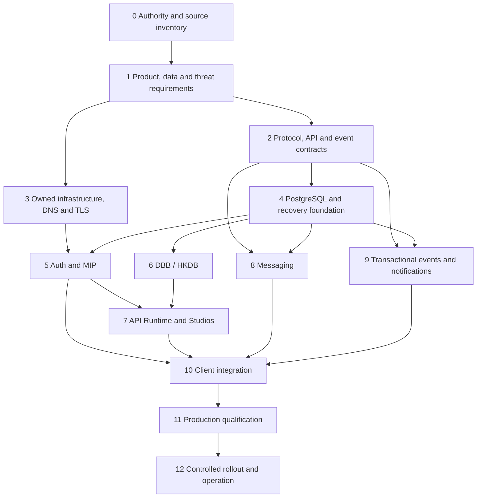

# MAATAA Service Fabric: Atomic Execution Plan

**Status:** gated engineering plan; no production gate is claimed closed by this document.
**Scope:** first-party Auth/MIP, API Runtime, DBB/HKDB, DB Studio, API Studio, messaging, notifications, event delivery, and their MAATAA Desktop/UI/Brahmini/TLPS clients.
**Basis:** current repository-local evidence, the owner decisions recorded in the domain and authority maps, and the existing service roadmap. External account access and live deployments have not been independently verified.

## Operating rules

1. Assign a named accountable owner and reviewer before implementation begins on each gate.
2. Use synthetic data until authorization, retention, backup and recovery pass their gates.
3. Do not migrate prototype identities, project records, messages or knowledge automatically. Each migration needs source inventory, mapping, dry-run, backup, reconciliation and an explicit cutover decision.
4. Keep service authority separate: Auth owns identity and grants; TLPS owns film/content; HKDB owns approved shared knowledge; Messaging owns conversation content; Notifications own delivery state; studios author proposals and do not become runtime authorities.
5. Every result is labelled `planned`, `implemented`, `locally tested`, `runtime verified` or `externally validated`. A lower state never implies a higher one.
6. Use established cryptographic primitives and maintained implementations. MIP semantics are first-party; do not invent cryptographic algorithms.
7. Do not expose a service publicly until ingress, TLS, secrets, authorization, recovery and operational ownership have evidence.

## Current baseline

- The alpha7 worktree contains a local Rust Auth/API process with SQLite, scoped opaque credentials, project records and a bounded knowledge-metadata slice. It is a prototype, not deployed service authority.
- MIP v1 is a design draft; interactive passkey enrollment/sign-in, production sessions and recovery are not implemented.
- Separate production Auth, DBB/HKDB, API Runtime, DB Studio, API Studio, messaging and notification services have not been established by the evidence reviewed here.
- `allb.xyz` is assigned to MAATAA, `tlps.in` to TLPS, and `nevoevents.in` to NEVO. NEVO DNS is reported by the owner to be in a separate Cloudflare account. The supplied zone exports are snapshots, not live evidence.
- The newer supplied TLPS zone export omits `staging.nevo.tlps.in`, which appeared in the previous snapshot; `staging.tlps.in` remains. This is not proof of live removal or migration to NEVO's domain.
- The current checkout has substantial pre-existing dirty and untracked work. Freeze and classify it before any release grouping; do not stage, commit, clean or move it as part of this plan.

## External systems and ownership claims

This is a claims/evidence register, not an access audit. “Owner-assigned” means a product/domain responsibility stated by the user; it does not prove the legal registrant or control of an account.

| External system or boundary | Current claim/evidence | What remains unknown | Gate/action |
|---|---|---|---|
| `allb.xyz` DNS | Assigned to MAATAA. Supplied archival zone export lists Cloudflare nameservers and apex/`www` records. | Registrar account, current live zone, admin access, DNSSEC, CAA, routing and change approvers. | Gate 3: authorized read-only verification, then document DNS change/rollback process. |
| `tlps.in` DNS | Assigned to TLPS. Newer archival export omits `staging.nevo.tlps.in` from the previous snapshot; `staging.tlps.in` remains. | Current live state, registrar access, tunnel owner/health, DNSSEC/CAA and mail sender ownership; whether NEVO staging moved to its own zone. | Gate 3: verify live removal and route plus NEVO's separate account; do not infer migration from the export diff. |
| `nevoevents.in` DNS | Assigned to NEVO; user reports a separate Cloudflare account. | Which operator is authorized in that account, registrar linkage, live records, DNSSEC/CAA, TLS, and whether MAATA/TLPS operators have any role. | Gate 3: have an authorized NEVO operator verify; do not assume shared Cloudflare access. |
| Cloudflare DNS/proxy/tunnel | Present in supplied zone snapshots; TLPS export references tunnel routing. This is an external infrastructure dependency even if domains and applications are owner-controlled. | Current account-to-zone mapping, enabled products, origin protection, support/recovery and failover strategy. | Gate 3: owner decides whether Cloudflare remains the edge/DNS provider or is replaced; document residual dependency and recovery. |
| Source hosting / GitHub | Existing authority notes list some external GitHub remotes, including ALLB and MAATA OS repositories. This turn did not fetch or re-verify them. | Account ownership, branch protection, backup/mirror, CI runner and secret exposure posture. | Gate 0/3: verify exact remotes on a clean evidence pass; decide owner-operated mirror/backup and CI control. |
| Email delivery | TLPS export contains MX/SPF/DKIM/DMARC configuration entries; this proves only snapshot configuration. | Actual sender/provider, domain administrator, delivery/rejection rates, key custody, bounce/complaint handling; MAATA sender domain not selected. | Gate 9: no transactional email until sender inventory, alignment, test delivery, unsubscribe and incident owner are verified. |
| Mobile push | No MAATA push deployment is evidenced. Apple/Google delivery would remain an external platform dependency if selected. | Whether push is required; app identities, provider account control, payload policy and token lifecycle. | Optional Gate 9 decision; base in-app notifications must work without it. |
| Hosting, certificates, secrets, monitoring | No production provider or live deployment was established in this review. | Host/region, TLS automation, secret/key store, log/metrics retention, alert recipient and recovery operator. | Gates 3 and 11: select owner-operated components and prove deploy, rotation, restore and incident response. |

Policy: owner-controlled application data does not imply that every DNS, certificate, delivery or source-hosting dependency is self-hosted. Record each accepted provider as a dependency with an owner, data boundary, recovery path and exit plan. Never copy credentials into this register.

## Dependency order

Gate 3 infrastructure preparation may proceed alongside contract design, but no public endpoint or real user data is allowed before its security subgates close.

## Atomic gates

| Gate | Atomic tasks | Gate closes only when |
|---|---|---|
| **0. Authority and baseline** | 0.1 Capture exact commit, branch, dirty paths and tool versions. 0.2 Inventory source repositories, prototypes, deployments, DNS zones and data stores. 0.3 Assign one accountable owner and source of truth per record family. 0.4 Separate owner claims from repository evidence and external verification. 0.5 Define migration freeze and preservation rules. | A repeatable inventory, owner/data matrix, exact baseline and unresolved-evidence register are reviewed. No unknown service is labelled canonical. |
| **1. Product, data and risk** | 1.1 Name user, operator and service-account actors. 1.2 Classify identity, knowledge, film, message, notification and telemetry fields. 1.3 Decide tenant/project boundary and cross-tenant denial semantics. 1.4 Set retention, export, deletion, audit visibility and legal-hold rules. 1.5 Set numeric SLO, peak load, RPO/RTO and incident-response ownership. 1.6 Decide server-readable encryption versus E2EE for messages. 1.7 Write abuse cases and threat boundaries. | Product/security owner signs measurable requirements and unresolved risks have an explicit disposition. |
| **2. Protocol and contracts** | 2.1 Finish MIP issuer/client/session/passkey/recovery/revocation state machines. 2.2 Define API request/response/error schemas and compatibility policy. 2.3 Define HKDB object/relation/assertion/provenance/lineage contracts. 2.4 Define event envelope, privacy classes and consumer permissions. 2.5 Define messaging and notification schemas independently. 2.6 Generate fixtures and negative compatibility tests. | Versioned specs and machine-readable fixtures exist; unknown versions, malformed events and unauthorized references fail closed. Protocol and threat reviews are recorded. |
| **3. Owned infrastructure and domains** | 3.1 Select operator-controlled hosts and isolated development/test/stage/prod. 3.2 Verify registrar and DNS admin access for `allb.xyz`, `tlps.in`, and `nevoevents.in`, including NEVO's separately administered Cloudflare account. 3.3 Verify whether `staging.nevo.tlps.in` is absent from the live TLPS zone and whether any replacement is routed under NEVO ownership; the latest export diff alone is insufficient. 3.4 Verify DNSSEC, CAA, TTL, DNS change approval and live records. 3.5 Define exact-host TLS, automated renewal, HSTS rollout and private service network. 3.6 Select owner-controlled secret/key storage, access, rotation and recovery. 3.7 Define firewall, egress and non-root identities. 3.8 Add reproducible builds, SBOM, artifact signing, vulnerability checks and redacted telemetry. | Account-level access is demonstrated without sharing credentials; live DNS/TLS/network checks and renewal drill pass; deployment definitions and owners exist. This owner map alone does not close Gate 3.2. |
| **4. Database and recovery** | 4.1 Select PostgreSQL version and owner-operated topology. 4.2 Create separate databases/schemas/roles for Auth, HKDB, messaging and notifications. 4.3 Add TLS/private access, least privilege, pool bounds and statement/transaction deadlines. 4.4 Make migrations reviewed, forward-only or explicitly reversible, checksummed and compatibility-tested. 4.5 Enforce tenant/project constraints in schema and service layer. 4.6 Configure encrypted backup plus WAL/PITR to owner-controlled storage. 4.7 Restore into isolated environment and measure RPO/RTO. 4.8 Exercise failover and pool saturation. | Fresh install, upgrade, isolation and recovery tests pass; measured restore evidence meets approved targets. |
| **5. MAATA Auth and MIP** | 5.1 Create Auth service and isolated database; prototype identities stay unmigrated by default. 5.2 Freeze issuer `https://auth.allb.xyz`, RP ID policy, ceremony origin and exact MIP client/callback registry. 5.3 Implement invite-only passkey enrollment and sign-in with maintained verifier. 5.4 Verify challenge, origin, RP ID, signature, credential status and user-verification policy. 5.5 Consume challenges atomically and test races/replay. 5.6 Implement exact-callback TLPS redirect and short-lived one-time code exchange with state and PKCE. 5.7 Issue separate host-only sessions; implement rotation, CSRF, expiry and logout. 5.8 Implement device/session listing and revoke-one/revoke-all. 5.9 Implement operator recovery, step-up, delay and immutable audit. 5.10 Add memberships, roles and project grants with deny-by-default. 5.11 Add rate limits, abuse handling, key rotation and emergency revocation. | Conformance suite, browser/native platform matrix, replay/race/revocation/recovery drills and independent protocol/security review pass before real accounts. |
| **6. DBB / HKDB** | 6.1 Separate HKDB into its own Rust process/service and store. 6.2 Implement typed knowledge objects, relations, claims/observations, evidence references, method/version, lineage and time basis. 6.3 Store large artifacts by approved reference/digest; never silently copy TLPS scripts. 6.4 Authorize every query and mutation by principal, tenant, project and scope. 6.5 Add append/history, conflict policy, dedupe, retention and deletion. 6.6 Add bounded deterministic search/retrieval with provenance in responses. 6.7 Add import/export and schema migration compatibility. 6.8 Audit reads/writes per approved policy. | Separate deployment and store; synthetic cross-tenant tests; conflict and migration tests; query output preserves sources and verification state. |
| **7. API Runtime and Studios** | 7.1 Split API Runtime from Auth and HKDB. 7.2 Validate issuer, audience, expiry, current revocation, tenant, project and scope on every protected request. 7.3 Authenticate private service-to-service calls. 7.4 Add limits, quotas, idempotency, pagination and optimistic concurrency. 7.5 Return stable machine-readable errors without internal detail. 7.6 Build API Studio for versioned contract authoring/review only. 7.7 Build DB Studio for migration/schema proposals and reviewed apply. 7.8 Generate provider/consumer compatibility tests. 7.9 Restrict service credentials to audience, scope, expiry and rotation. | Negative auth/isolation tests and compatibility tests pass against deployed test services; no client gets database credentials. |
| **8. Messaging** | 8.1 Freeze membership, retention, edit/delete, export and moderation policy. 8.2 Implement selected encryption model before production content. 8.3 Create separate store/service; authorize membership on every read/write and reconnect. 8.4 Specify acknowledgement, message ID, ordering scope, dedupe and retry. 8.5 Add authenticated WebSocket/SSE with revalidation, backpressure and resumable cursor. 8.6 Treat attachments as separately authorized objects with limits/scanning. 8.7 Add block/report/abuse and delete/export paths. 8.8 Test offline, reconnect, revocation, duplicate delivery, ordering and restore. | Revoked members lose access; retries do not duplicate side effects; reconnect resumes safely; retention and deletion are demonstrated. |
| **9. Events and notifications** | 9.1 Implement the transactional outbox/inbox design in `MAATAA-NOTIFICATION-OUTBOX-DESIGN.md`. 9.2 Define event ownership and an allowlisted notification-producing event set. 9.3 Start with in-app delivery and user preferences; keep message bodies out of notification payloads. 9.4 Add retries, dedupe, expiry and dead-letter review. 9.5 Add email only after sender/domain controls and delivery tests. 9.6 Treat mobile push as an optional platform dependency. 9.7 Test crash windows, outages, duplicate/reordered events and privacy leakage. | Commit-to-delivery trace proves durable handoff; consumer is idempotent; preference and privacy tests pass; channel dependencies are disclosed. |
| **10. Product integration** | 10.1 Define OS secure credential-store bridge. 10.2 Add browser/native passkey handoff using registered callbacks and one-time codes. 10.3 Integrate Desktop, MAATA UI, Brahmini and TLPS with shared Auth/API services. 10.4 Keep TLPS content authoritative there; send only approved references/metadata to HKDB. 10.5 Add scopes/consent/account-switch/offline states. 10.6 Match Electron/Tauri behavior and notification permissions. 10.7 Test keyboard/accessibility, cancellation, expiration, revocation and session expiry. | Native/browser E2E shows one principal and project record through all authorized hops; stale/revoked state denies immediately. |
| **11. Production qualification** | 11.1 Scan dependencies, licenses, secrets and SBOM. 11.2 Complete independent security assessment and remediate findings. 11.3 Fuzz protocol parsing, migrations and authz boundaries. 11.4 Run load, soak, failure and restore/failover exercises against approved targets. 11.5 Verify TLS, CORS, cookies, CSRF, firewall and egress externally. 11.6 Drill incidents, key compromise and recovery. 11.7 Tie evidence to exact commit and artifact; prove rollback. | Signed exact-release evidence, no unresolved critical security finding, successful restore/rollback, named operators and release approval. |
| **12. Controlled rollout and operations** | 12.1 Deploy synthetic canary. 12.2 Observe service health, latency, errors, event lag and dead letters. 12.3 Enable operator accounts only after Gate 11. 12.4 Roll out bounded cohorts with stop/rollback triggers. 12.5 Review access and retention periodically. | Rollout gates and rollback triggers pass; on-call owner accepts service and audit trail. |

## Immediate backlog from this audit

These items are documentation/design work and can be completed without account credentials or DNS changes:

- [x] Capture a repository-local Gate 0 snapshot and mark its limits.
- [x] Record logical domains, known external providers and account boundaries; keep registrar/DNS proof open.
- [x] Define transactional outbox/inbox behavior and its failure tests.
- [x] Link the detailed service roadmap, domain authority map and outbox design below.
- [ ] Obtain owner confirmation of service/data owners, including who administers each DNS account; do not request or store credentials in this repo.
- [ ] Verify live removal of `staging.nevo.tlps.in` and whether NEVO staging is routed under `nevoevents.in`; assign a migration owner/expiry if it remains.
- [ ] Set numeric SLO/RPO/RTO, expected peak throughput, retention and message encryption policy.
- [ ] Select owner-operated hosts, secret/key mechanism and restore destination.

## Durable references

- [Production service roadmap](MAATAA-PRODUCTION-SERVICE-ROADMAP.md)
- [Domain authority map](MAATAA-DOMAIN-AUTHORITY-MAP.md)
- [Identity Protocol v1 design](MAATAA-IDENTITY-PROTOCOL-V1.md)
- [Notification transactional outbox design](MAATAA-NOTIFICATION-OUTBOX-DESIGN.md)
- [Current authority and implementation evidence](MAATAA-AUTHORITY-MAP.md)
